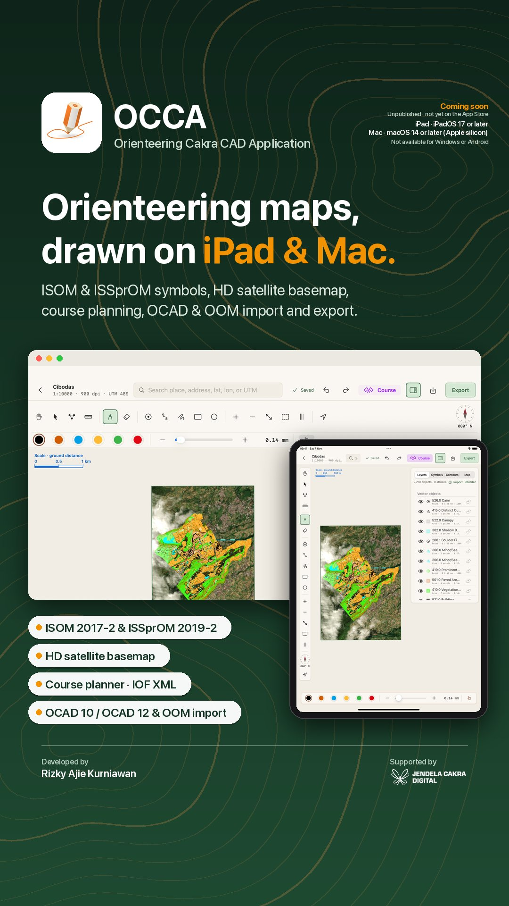
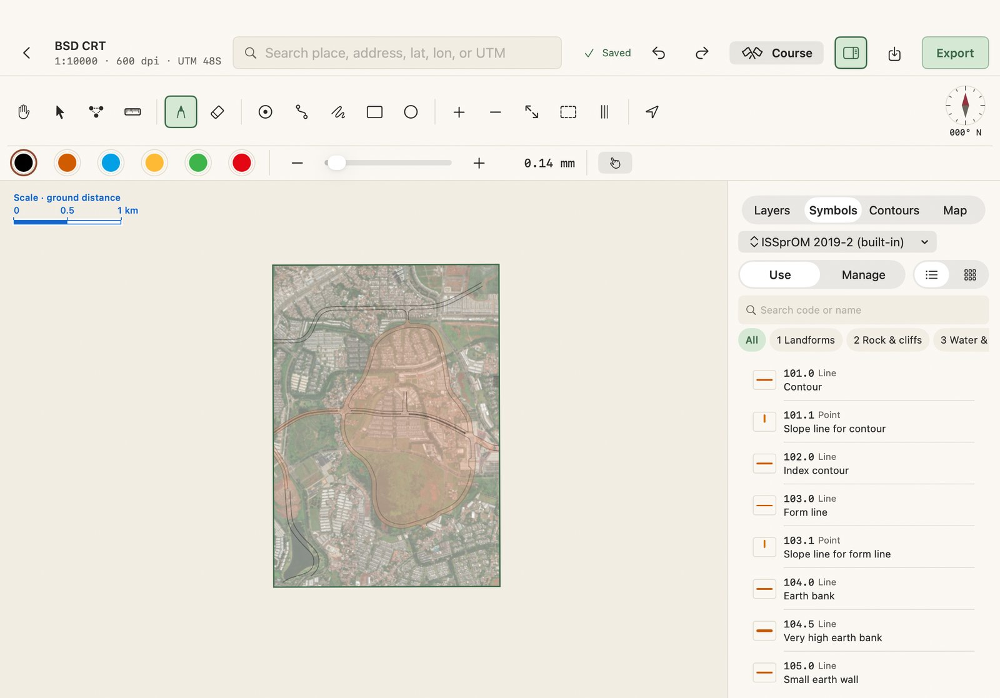
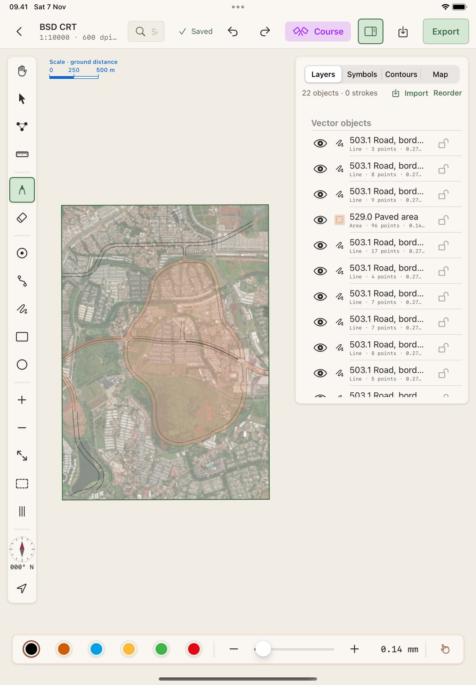
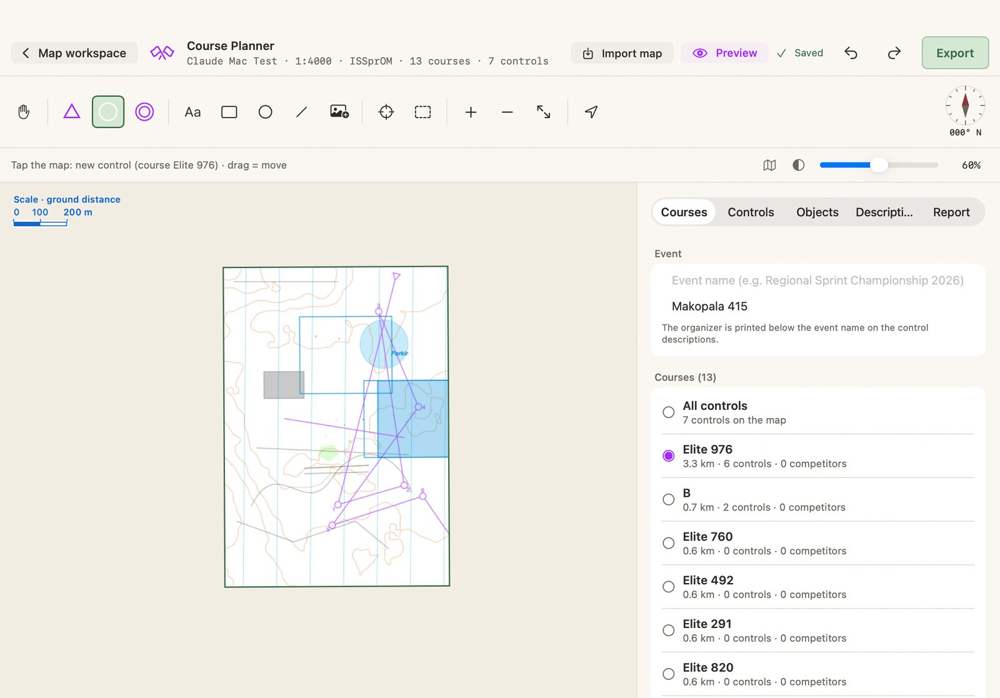
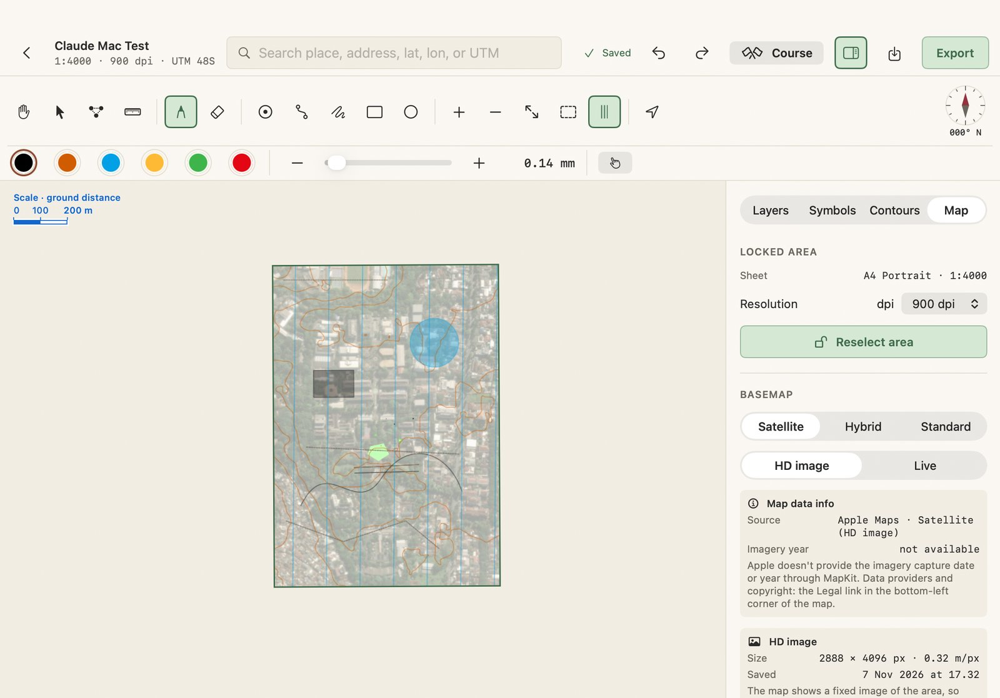
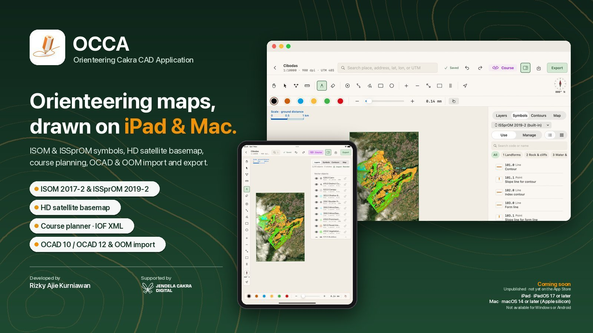

# OCCA — Orienteering Cakra CAD Application



An orienteering map CAD app for **iPad and Mac**: draw, edit, and print ISOM/ISSprOM maps on top of satellite
imagery or your own GeoTIFF basemap. Georeferenced map frame (UTM), IOF symbols from OCAD symbol sets with Color
Hierarchy, OCAD/OOM-style vector tools (bezier pen, Move/Node/Measure, follow object, merge), Apple Pencil sketching,
contours from a DEM, an IOF Course Planner, and export to raster + world file, GeoPDF, OMAP, and `.occa` project
files that open on both iPad and Mac.

> Former names: Cakra Pencil, then COCA. The repo, Xcode target, Swift module, and bundle id (`id.cakrapencil.app`)
> are unchanged; old `.coca` and `.cpencil` files still open.

- **Release:** Coming soon — **unpublished**, not yet available on the App Store (current version 0.1.0).
- **Supported:** iPad with **iPadOS 17 or later** (Apple Pencil optional) and Mac with **Apple silicon and macOS 14
  Sonoma or later** (via Mac Catalyst, "Optimize for Mac" interface). Features are the same on both devices; the
  layout adapts to the device (see [iPad and Mac](#ipad-and-mac)).
- **Not supported:** Windows, Android, and iPhone.
- **Compatible files:**
  - **OCAD 10, OCAD 12 … OCAD 2018** (`.ocd`): maps and course setting files (controls and courses) — tested with
    real OCAD 10 and OCAD 12 files.
  - **OOM — OpenOrienteering Mapper** (`.omap`, `.xmap`): maps, and start / control / finish symbols as controls.
  - **OCCA** (`.occa`) project files, **GeoTIFF** basemaps.
  - Export: OOM `.omap`, DXF (for OCAD), IOF XML 3.0 courses, georeferenced PDF, PNG / TIFF / JPEG + world file.
- **License:** proprietary, © 2026 Rizky Ajie Kurniawan — see [LICENSE](LICENSE).

<br clear="right">

## Features

**Map making**
- Georeferenced A4 map frame in UTM (WGS84), scales 1:1000–1:15000 in steps of 500, lock/unlock and reselect the area.
- Basemaps: Apple Maps Satellite / Hybrid / Standard as a saved **HD image** of the locked area (fixed at every zoom)
  or **Live**, your own **GeoTIFF**, one opacity control, and Map data info.
- ISOM 2017-2 and ISSprOM 2019-2 symbols from OCAD symbol sets, drawn with the OCAD **Color Hierarchy**
  (e.g. 509.1 railway as a black line with white dashes).
- OCAD/OOM-style vector tools: bezier Pen, Freehand, Rectangle, Ellipse, Move Tool, Node Tool
  (Convert to Sharp / Smooth / Smart), Measure Tool, follow object, auto-join, **Join / Merge**, fill area,
  cut / split / scale / parallel, precise Shift-rotation.
- Apple Pencil sketching with ISOM pen presets; contours from a DEM (built-in Terrain Tiles, GeoTIFF, ASCII Grid,
  GeoJSON) with interval, index and form lines.
- North lines grid (grid or magnetic north) with quick show/hide (⇧⌘G), labeled scale bar, and frame corners in
  UTM, decimal degrees, and degrees-minutes-seconds.

**Course planning**
- Separate Course Planner page like Purple Pen: start / controls / finish, multiple courses sharing controls,
  automatic codes, lengths and climb, checks, illustrated IOF 2018 control descriptions, course objects
  (text, shapes, images), one-page race maps.

**Files and export**
- `.occa` project files that open on both iPad and Mac (Files, Finder, AirDrop).
- Import OCAD 10–2018 (.ocd) and OOM (.omap / .xmap) maps, and OCAD course setting files (controls and courses) —
  into a project, or straight from the project list as a new project.
- Export PNG / TIFF / JPEG + world file, georeferenced PDF (GeoPDF), OOM .omap, DXF, IOF XML 3.0, contours to
  Shapefile / KML / KMZ — optionally with the georeferenced basemap underneath. Back to OCAD: DXF for the map,
  IOF XML 3.0 for the courses (OCAD Course Setting import), raster + world file or GeoPDF as a background map.

**Two devices, one app**
- The same features on iPad (touch, Apple Pencil) and Mac (mouse, trackpad, keyboard shortcuts); the layout adapts
  to each device.

## Screenshots

| Mac — map workspace | iPad — map workspace |
| --- | --- |
|  |  |

| Mac — Course Planner | Mac — Map tab (HD image / Live, map data info) |
| --- | --- |
|  |  |

## iPad and Mac

| | iPad | Mac (Mac Catalyst) |
| --- | --- | --- |
| Tools | Tool rail on the left (two columns on short screens), pen dock and object bar at the bottom | Toolbar band docked at the top: tools + map controls + pens in one row, object bar in the next row, compass in the right corner |
| Right panels | Floating panels | Docked full height on the right side |
| Sizes | 44 pt buttons, iPad font sizes | 36 pt buttons, smaller fonts (`CP.fs`) |
| Input | Touch, Apple Pencil (hover, double-tap), optional keyboard | Mouse/trackpad: two-finger scroll = pan the map, pinch / ⌘ + scroll = zoom, Shift for multi-select and precise rotation |
| Other | Compass follows the iPad's heading | No digital compass, hidden window title, minimum window size 1100 × 760 |

Shared logic lives in `CakraCore` and the models; view branching uses `CP.isMac`.

## Status: G1 foundation

| Area | Done | Not yet (next) |
| --- | --- | --- |
| Project (FR-1) | New project (name, scale, dpi), scales 1:1000–1:15000 in steps of 500, automatic UTM CRS, A4 Portrait/Landscape frame, live scale change, margins, corner snap, lock/unlock, frame info, `.cakra` package | Multi-sheet/A3, non-UTM EPSG (needs PROJ) |
| Home screen | Project cards with imagery + vector preview (projects whose area is not locked yet show a "No area selected" card without a photo), search, sort, rename, duplicate, save `.occa` file, **Open file** (`.occa` project, or an OCAD `.ocd` / OOM `.omap` `.xmap` map → **New project from map**: name, UTM zone — OCAD files don't store it, so the sheet checks it: a preview map with a pin at the map center, the place name from Apple geocoding (red warning when the center lands in the sea, plus a confirmation before Create), **Suggest zone** (tries neighboring zones until the map lands on land), and an automatic correction when the starting zone puts the map in the sea; OOM sets the zone from the file — then a project with its area locked on the map, objects and OCAD courses included), delete | Project folders/tags |
| View | Select area with a fixed frame in the center, map limited to the locked area, search with suggestions, two-finger rotation, zoom +/− (down to ±2 mm/pt), **Show whole map** button (⌘0: frame + all objects, sketches, and courses), zoom to frame, digital compass (follows the iPad's heading) — map controls merged into the left tool panel (two columns when a landscape screen is not tall enough), basemap opacity, north grid lines (grid/magnetic, spacing, color, opacity, width; settings in the Map tab → North line grid, quick show/hide with the north lines button in the map controls, ⇧⌘G, or the eye in Layers → Grid) | Field mode |
| Field (FR-5) | GPS position radar: accuracy circle, radar pulse, heading cone, accuracy badge, show/hide | GPX track recording, photo notes, averaging |
| Imagery (FR-2) | Apple Maps satellite/hybrid/standard, GeoTIFF image basemap (see the row below), one opacity control for the active basemap, **Map data info** | Import photo + world file, GCPs |
| HD image (locked area) | Once the area is locked, Satellite, Hybrid, and Standard are each downloaded once as a georeferenced HD image of the frame + 5% margin (MKMapSnapshotter, ~0.25 m/px, longest side ≤ 4096 px, Web Mercator bounds) — current type first. The workspace then shows the fixed image instead of the live Apple map, so roads and buildings keep their size at every zoom; switching type uses the saved image. Live map while downloading or offline; **Download again** in the Map tab. **Basemap mode** in the Map tab keeps the two separate: **HD image** (default, the saved image) or **Live** (real-time Apple Maps for checking current conditions while online; saved per project); HD images keep downloading in Live mode, so exports can still include the basemap. Stored in the package under `imagery/` as a per-device cache (not in `.occa` files) | Imagery capture date (not provided by MapKit) |
| Sketch (FR-3) | Pencil with constant mm width, ISOM presets, stroke eraser, undo/redo, Pencil draws / finger navigates, Pencil double-tap, two/three-finger tap | Pixel eraser, lasso, Metal engine |
| Vector (FR-4) | Bezier pen tool (double-tap = finish, continue a line from its end), freehand, Rectangle, Ellipse, snap to points of other objects, Node Tool (A): edit points/handles, drag the segment between two points = bend that segment (end points stay put, corners stay corners); active point → Convert to Sharp / Smooth / Smart (smart = automatic handles that adjust when the point or its neighbors move; double-tap a point = sharp ↔ smooth), rotation 0–360°, Layers panel (show/hide, lock, order, rename, duplicate, delete) | Editing several points at once |
| Symbols (FR-4.2) | Symbol set library from .ocd (ISOM 2017-2, ISSprOM 2019-2, school; built-in ISSprOM set), enable/disable per set and per symbol, list/6-column grid, point/line/area symbols with the matching tool, IOF widths (double lines, dashes, caps; e.g. 509.1 railway: black line with white dashes), solid area fill like OCAD/OOM, change an object's symbol (point ↔ point, line ↔ area; one object or every object with the same symbol) | Area hatch patterns, symbols along a line (fences, cliffs) |
| Contours (FR-8) | Built-in contours (AWS Terrain Tiles, stored in the project for offline use), upload a DEM GeoTIFF/ASCII Grid or GeoJSON contour lines, interval/index/form line/smoothing/display panel, interval warning, relief info, opacity up/down, convert to vector objects, included in export (101.0/102.0/103.0), export contours only to Shapefile/KML/KMZ | Elevation labels, hillshade |
| Merge, follow object, fill area | Like OCAD/OOM: a line end placed on the end of a line with the same symbol, and an area whose side is placed on an area with the same symbol, merge right away (always on, no button); a **Join** button for lines (gap ≤ 2 mm on paper) and **Merge** for areas (touching/overlapping) appears at the front of the bar when objects with the same symbol meet, and when several objects are selected (⌘J; merges only with other selected objects). **Follow object** (always on, no button): a first tap then a second tap on the same object = its shape is followed, across kinds (a line symbol follows lines or areas, an area symbol follows areas or lines; closed lines are followed along the shortest side like areas; a line lying exactly on an area edge counts as the same object); the cursor snaps to object edges in every drawing tool (pen, freehand, rectangle/ellipse, point symbol); two consecutive pen taps on the same object copy the shape between them (including up to the object's end; overlapping lines are not merged), returning to the start point with a line symbol = a closed line (not an area), freehand along an object follows its shape; guides show during Apple Pencil hover. **Fill area**: the selected line is filled with a new area symbol below it, the line stays | Areas with holes (a merge that forms a ring keeps only the outer edge); merged overlapping areas lose their bezier curves |
| Multi-select & duplicate | Move Tool (V): tap = select a whole object (no points), drag = move, **rotation handle** above the selected object (drag = rotate around its center; **Shift** = precise: a straight side snaps parallel/perpendicular to a straight line of a nearby object or grid north, within 4°, the reference side is highlighted; otherwise 15° steps), double-tap a selected object = enter Node Tool; click and drag on empty space = selection box (replaces the selection; pan with two fingers or the Navigate tool), tap empty space = deselect all; Shift + tap / Shift + box = add to selection, ⌘A = select all (no button). Selected objects move together, **Duplicate** (⌘D: copy 3 mm on paper to the lower right, right above the original, selected immediately) and **Delete N objects** — each one undo step | Point/shape editing, symbol change, and rotation work on one object only; locked/hidden objects are not included in the selection box |
| Pan the view | Navigate tool (H): one-finger drag/click-drag; in every tool: two fingers, **trackpad/mouse scroll**, trackpad pinch = zoom at the cursor, **⌘ + scroll** = zoom | Trackpad scroll/pinch not covered by automated tests (iOS XCUITest cannot send scroll events); direction checked manually on Mac |
| Save & open project files | **Save file** (⌘S in the map workspace top bar, or the project card menu) → one `.occa` file with the whole project (objects, sketches, courses + their images, contours, DEM, preview; LZFSE). **Open file** (⌘O in the project list), or open an `.occa` (or old `.coca` / `.cpencil`) from Files / Finder / AirDrop. The format is the same on iPad and Mac, so a file from one device can be imported on the other. Existing projects are never overwritten: same id → an "(imported)" copy | No automatic sync (iCloud) yet; files are saved/moved manually |
| Reselect area | Map tab → **Reselect area**: the old area is kept (also in the project file); while the new area is not locked, the basemap/imagery stays visible and **Cancel** (Esc) restores the previous area, scale, orientation, margins, and snap and locks it again | — |
| Image basemap (GeoTIFF) | During **Select map area**: the **Skip — upload basemap** button → choose a GeoTIFF, the UTM zone is taken from the image, the frame (chosen scale/orientation) is centered on the image, the area is locked right away, and the image becomes the basemap. Or at any time in the **Map** tab → **Import GeoTIFF basemap…**: georeferenced imagery/maps (GeoTIFF tags; UTM WGS84 any zone or WGS84 lat/lon) show in the map workspace below the objects. While it is in use (**Use**), the Satellite/Hybrid/Standard picker is disabled and Apple imagery is hidden (except while selecting an area); Opacity + Hide/30/60/100% apply to the active basemap; zoom to image, replace, delete. An image that does not touch the frame → offer to **Move frame to image** (undoable). The file is copied into the project package (included in .occa files and duplicates). Large images: a ≤ 2048 px version when zoomed out, full resolution when zoomed in | Rotated GeoTIFFs (ModelTransformation), world files (.tfw), and CRSs other than UTM/WGS84 are not supported; the area outside the frame is masked like satellite imagery |
| Measure Tool | Measure tool (R): drag from point to point → ground distance (m), length on paper (mm at map scale), and grid azimuth; ends snap to point symbols, corners, and object edges. Esc / Clear measurement = clear | UTM grid azimuth (not corrected for magnetic declination); one straight segment, no polyline yet |
| Color Hierarchy (Symbol Layering) | Color stacking follows the OCAD Color Table order of the symbol set (built-in: ISSprOM 2019-2): colors higher in the table automatically cover colors below, regardless of drawing order — e.g. black over blue, blue over brown, brown (contours) over green and yellow, road fill over its black edges. Applies on the map, PNG/TIFF/JPEG export, GeoPDF, and .omap (color order = OOM priority); tapping an object selects the one visible on top. Objects of the same color follow the Layers panel order; sketches without a symbol sit above everything | The Layers panel order only matters among objects of the same color; on the map, generated/imported contours are drawn above all objects (export already uses the correct color order); older imported symbol sets must be re-imported to pick up their color order |
| Tooltips | Every icon button (tool panel, object bar, pen dock, top bar, Course/Layers/Contours panels) shows its name and keyboard shortcut when the mouse/trackpad pointer hovers over it | On touch screens without a pointer tooltips do not show (names are still read by VoiceOver) |
| Shape editing (OCAD) | Reshape: move/delete points, corner ↔ smooth, **add point** (double-tap on the selected object's line, the curve shape stays). **Edit shape** menu: **Cut line** (tap one point) / **Split area** (tap two points on the edge), **Scale** (10–400% slider or buttons, line width unchanged), **Parallel** (copy/move parallel to the left, right, or both sides; areas: inside/outside), **Reverse line direction**; Rotation stays on the Rotate button, Join via the Join button | Cutting areas with a freehand line (only straight lines between two points for now); parallel offsets of sharp curves use a simple miter |
| Course planner | A separate Course page (Course button in the workspace) like Purple Pen, with **Import course** (top bar and the Courses list): controls and courses from an `.occa` project (descriptions kept, positions converted to this project's zone), an OCAD course setting `.ocd` (OCAD 10–11 control strings and OCAD 12+ control object strings; map exchanges are skipped), or the start/control/finish symbols (701/702/706) of an OOM `.omap`/`.xmap` (OOM has no course order; controls get free codes); the background is only the drawn map (no imagery) with map intensity, import OCAD/OOM maps (.ocd, .omap, .xmap) as background, Start/Control/Finish rail, Courses · Controls · Descriptions · Report panels. Course names can be typed directly on the course card. The organizer name is printed centered below the event name in the descriptions. Multiple courses (ordered/score) share controls and start/finish, automatic codes 31–255 (skipping ambiguous codes) + renumber, drag to move, reorder, length + legs, climb, competitors, load per control and shared legs, checks, illustrated IOF 2018 descriptions with columns A–H (symbols C–H, thick lines after C and F, navigation finish row; text style option; black or purple like the controls; symbol icons in the picker), IOF standard symbol sizes that can be changed (globally and per control), PDF preview before export, one-page race map (descriptions in a chosen corner or a free position dragged on the map thumbnail, row limit per column: extra rows move to the next column; separate description page option), **Objects** tab: text (multi-line, font size in mm/pt, bold, italic), rectangle/ellipse (optional transparent purple fill), lines, and JPG/PNG images (max 10 MB, 8000 px, 10 images; downscaled to 2000 px; PNG transparency kept) that can be dragged, any color (quick colors + color picker), shown on all courses or selected courses, included in PDF and PNG; **All controls** (master: control codes, no legs) can be previewed and exported as PDF/PNG with control descriptions sorted by code, IOF XML 3.0 export + race map PDF + PNG with world file | Description sheet inside the map, crossing points/forbidden areas, variations (butterfly/forking), relays |
| Import | OCAD 10–2018 (.ocd) and OOM (.omap/.xmap): lines + areas with curves, georeferencing, colors, symbol codes, dashes. **OCAD course setting files** (.ocd with courses) go straight into the Course Planner: start / controls / finish at their positions and every course in order (Import in Layers or Import map on the Course page) | OOM point objects, text, area holes; OCAD control descriptions (OCAD's own numbering) are not converted |
| Export (FR-6) | PNG/TIFF/JPEG 300/600/900 dpi + .pgw/.tfw/.jgw + .prj, .omap (original bezier curves) and DXF R12, georeferenced vector PDF (Geospatial PDF), grid included in export (601.0), pre-export check, Share Sheet. **Include basemap** (off by default; map sheet and course exports): the basemap in use (HD Apple Maps image or GeoTIFF) georeferenced under the map in PNG/TIFF/JPEG and PDF at the current opacity, with an "Imagery © Apple Maps" credit for Apple imagery; OMAP/DXF get `<name>_basemap.jpg` + .jgw + .prj, and the .omap references it as a georeferenced image template behind the map | Striped rendering via libtiff, Shapefile, GeoJSON, GPX, ZIP; open tests in OOM 0.9.x and OCAD |
| Storage | Atomic JSON + Data Protection, debounced background autosave | SQLite + GRDB + R*Tree |

Symbol codes in export: objects drawn with a symbol (or imported from OCAD) carry their original ISOM code,
e.g. `101.0 Contour` in .omap and layer `101_0_CONTOUR` in DXF. Pencil sketches and objects without a symbol use the
neutral code `990.x` per color + width.

RTK (FR-7) is not started yet.

Tool shortcuts: H navigate, V Move Tool, A Node Tool, R Measure Tool, N pencil, E eraser, T point symbol,
P pen tool, F freehand, M rectangle, L ellipse. In the pen tool: Return = finish line, Delete = remove the last
point, Esc = cancel.

Command shortcuts: ⌘Z / ⇧⌘Z undo/redo, ⌘A select all, ⌘D duplicate, ⌘J join/merge, ⌘0 whole map,
⌘= / ⌘− zoom, ⇧⌘G north lines, ⌘S save `.occa` file, ⌘E export, ⌘K Course Planner; in the project list ⌘N new project, ⌘O open file.

## Structure

```
CakraPencil.xcodeproj         App target "OCCA" (iPadOS 17 + Mac Catalyst), synchronized folders (no manual file list)
Config/CakraPencil-Info.plist .occa project file type (UTI id.cakrapencil.project), merged with Xcode's generated Info.plist
CakraPencil/                  SwiftUI + UIKit (Swift module still "CakraPencil")
  App/                        Entry point, Mac window, debug snapshot
  DesignSystem/Tokens.swift   Color, spacing, per-device font/button size tokens, button styles
  Projects/                   Project list, new project, About (credits), .cakra repository, .occa files
  Workspace/                  Workspace model, MKMapView + frame + Pencil ink + vector layer, panels, Course Planner
  Symbols/                    Symbol set library (.ocd) and symbol panel
  Export/                     Export sheet
  Resources/SymbolSets/       Built-in ISSprOM 2019-2 symbol set (.ocd)
  CakraPencilMac.entitlements Mac sandbox (network, user-selected files, location)
CakraPencilUITests/           XCUITest (iPad simulator)
Packages/CakraCore/           Pure logic (iOS + macOS), tested with `swift test`
  Geodesy/                    UTM WGS84 (Krüger series), zones, .prj WKT
  Sheet/                      Paper/ground/pixel sizes, north-up frame, snap, scale presets
  Georef/                     World files
  Sketch/                     Strokes (mm), ISOM pen presets
  Vector/                     Bezier objects, symbols, merge, follow object, shape editing, Color Hierarchy, precise rotation, measure
  Contour/                    DEM (GeoTIFF/ASCII Grid/Terrain Tiles), contour generation, contour export
  Course/                     Course Planner, overprint, IOF descriptions, IOF XML
  Import/                     OCAD (.ocd) and OOM (.omap/.xmap) readers
  Export/                     Raster, GeoPDF, OMAP/DXF
  Project/                    Project model, .cakra package, .occa files, GeoTIFF basemap
  Support/                    Number formatting, app identity (AppInfo)
Tools/                        Logo generator script
docs/images/                  README images (promo, screenshots)
```

## Running

```sh
# Core tests (UTM, frame size table, world files, export roundtrip ≤ 1 px, 900 dpi export budget)
cd Packages/CakraCore && swift test

# App: open in Xcode, pick an iPad simulator / physical iPad, or "My Mac (Mac Catalyst)", then Run
open CakraPencil.xcodeproj

# Build for Mac (Release) and install to /Applications/OCCA.app (signed "Sign to Run Locally")
xcodebuild build -project CakraPencil.xcodeproj -scheme CakraPencil -configuration Release \
  -destination 'platform=macOS,variant=Mac Catalyst' -derivedDataPath .build/mac
ditto .build/mac/Build/Products/Release-maccatalyst/OCCA.app /Applications/OCCA.app
```

This Mac build only runs on the Mac that built it. Other Macs need a Developer ID + notarization (Apple Developer
Program); for the Mac App Store, the sandbox is already set up in `CakraPencilMac.entitlements`.

The simulator has no Apple Pencil. Turn on the hand button in the pen dock so one finger draws too.

DEBUG builds accept launch arguments for screenshots/UI tests, including: `-cp-open-first`, `-cp-open-project <name>`,
`-cp-inspector-tab <Layers|Symbols|Contours|Map>`, `-cp-use-symbol <number>`, `-cp-select-first`, `-cp-open-course`,
`-cp-reselect-area`, `-cp-import-basemap <file>`, `-cp-skip-area-basemap <file>`, `-cp-save-file <name>`,
`-cp-import-file <file>`, `-cp-force-shift`, and `-cp-snapshot <name>` (saves a window image to the app's Documents —
used to check the Mac layout without screen recording permission; UI tests on Mac need signing with a Team).

UI tests (XCUITest, target `CakraPencilUITests`, iPad simulator): project deletion, contours-only export, OCAD/OOM-like
drawing, symbol change, rotation (including Shift + precise rotation), multi-select + duplicate, Move/Node/Measure Tool,
Convert to Sharp/Smooth/Smart, merging (Join/Merge), follow object across kinds, Color Hierarchy, and the course
planner. Some tests use the "Uji Vektor" test project on the simulator.

```sh
xcodebuild test -project CakraPencil.xcodeproj -scheme CakraPencil \
  -destination 'platform=iOS Simulator,name=iPad Air (5th generation)' -only-testing:CakraPencilUITests
```

Performance test: run the app with `-cp-open-project "Uji Performa" -cp-perf` (Debug build, or Release with
`SWIFT_ACTIVE_COMPILATION_CONDITIONS=DEBUG` for numbers like the installed app). The app adds 600 strokes + 200 objects,
measures rotation, pan, zoom, drag, and contour recalculation, then the Course Planner (60 controls + 6 courses):
overprint, load, checks, race map PDF, IOF XML, the Course page (rotate/pan/zoom, drag a control, panel changes).
Results go to `Documents/perf.txt`; course data is restored at the end (back up the test project if you don't want
strokes/objects added). Options: `-cp-course-tab Report` (panel tab), `-cp-course-no-panel` (no panel).

Latest results (iPad Air simulator, Release): map workspace and Course page at 60 fps without hitches; control drag at
60 fps; race map PDF with 625 objects in 30 ms; IOF XML 1.5 ms; opening the Course page 0.3 s; course data changes
23–54 ms per change.

## Credits



- Developed by **Rizky Ajie Kurniawan**.
- Supported by **PT. Jendela Cakra Digital** — [jcdigital.co.id](https://jcdigital.co.id).

The in-app **About OCCA** screen (ⓘ in the project list, or tap the credit footer) shows the same credits with the
company logo, the release date and supported platforms, plus the third-party data notices.

<br clear="right">

## License

Proprietary — © 2026 Rizky Ajie Kurniawan. All rights reserved. This code and app may not be used, copied, modified,
or shared without written permission. Third-party data and components (BOF ISSprOM symbol set, Apple Maps imagery,
Terrain Tiles elevation data) are subject to their own terms. See [LICENSE](LICENSE).
